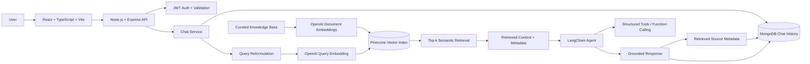

# chatbotRAG

A full-stack conversational AI prototype exploring **Retrieval-Augmented Generation (RAG), vector search, agent tool-calling, conversational memory, authentication, source provenance, and a production-style web application layer**.

The project was built as a hands-on portfolio project to understand how modern LLM application components fit together beyond a simple chat-completion call.

> **Important:** This repository is an educational/portfolio prototype. It is **not a medical product** and must not be used for diagnosis, treatment, or crisis intervention. Any crisis-support behavior in the code should be treated as prototype logic and replaced with current, jurisdiction-specific, professionally reviewed resources before real-world use.

---

## What this project demonstrates

- Full-stack application development with **React, TypeScript, Node.js, Express, and MongoDB**
- Document embedding and vector indexing with **OpenAI Embeddings + Pinecone**
- **Semantic similarity search** with cosine similarity
- **Top-k retrieval** from a vector database
- Retrieval metadata including source, title, category, URL, and document content
- **Query reformulation** for more retrieval-friendly user queries
- Explicit injection of retrieved knowledge into the LLM/agent context
- Agent orchestration with **LangChain**
- **OpenAI function calling** and custom tool execution
- Structured tool inputs with **Zod schemas**
- Retrieval provenance returned with assistant responses
- Session-based conversational history stored in MongoDB
- JWT-based authentication with signed, HTTP-only cookies
- Request validation, rate limiting, security middleware, and centralized API handling
- Separation between a standard LLM chat path and a RAG/agent path

---

## Architecture



### High-level request flow

1. A user signs in and starts or resumes a chat session.
2. The React client sends the user message and session ID to the Express API.
3. The backend loads recent conversation history from MongoDB.
4. The user's message is reformulated into a more retrieval-oriented query.
5. The reformulated query is embedded and used for semantic search against Pinecone.
6. The top-k retrieved documents are converted into contextual knowledge for generation.
7. The retrieved context and conversation history are passed into the LangChain agent.
8. The agent can generate a response directly or invoke a structured tool when appropriate.
9. The assistant response and retrieved source metadata are persisted in MongoDB.
10. The frontend displays the response together with the retrieved sources.

---

## RAG and retrieval pipeline

### Knowledge base

The repository includes a small curated JSON knowledge base containing mental-health resources. Each record includes fields such as:

- `title`
- `content`
- `source`
- `category`
- `url`

The current dataset is intentionally small and exists to demonstrate the retrieval architecture rather than production-scale knowledge management.

### Embedding and indexing

`backend/src/scripts/index_data.ts`:

1. Reads the JSON knowledge base.
2. Generates an embedding for each resource using `OpenAIEmbeddings`.
3. Creates or uses a Pinecone index named `mental-health-index`.
4. Stores each vector with metadata including:
   - title
   - source
   - category
   - URL
   - original page content
5. Uses cosine similarity as the vector-index metric.

The current implementation uses the embedding model configured through environment variables. Model and API selections should be reviewed when modernizing or redeploying the project because the GenAI ecosystem evolves rapidly.

### Semantic retrieval

The live RAG path executes semantic similarity search against Pinecone using the reformulated user query.

The current implementation retrieves the top matching documents and extracts both:

- document content for LLM context
- metadata for source provenance

The repository also includes `backend/src/scripts/test_pinecone.ts` for independently validating vector retrieval.

Retrieval capabilities demonstrated include:

- semantic similarity search
- top-k retrieval
- metadata inspection
- metadata filtering in retrieval tests
- source/title/category/URL provenance
- source deduplication before returning provenance to the UI

### Query reformulation

Before retrieval, conversational user messages are reformulated into more retrieval-oriented queries.

For example, a vague input such as:

> “I feel stressed.”

can be transformed toward a query such as:

> “stress management techniques”

The goal is to reduce the mismatch between conversational language and the wording likely to produce useful retrieval results.

### Context injection

After retrieval, the selected documents are explicitly formatted into a context block and supplied to the agent along with:

- recent conversation history
- the original user query
- the reformulated query
- retrieved knowledge

This connects the retrieval layer directly to response generation rather than treating retrieval as a separate demonstration component.

---

## Source provenance

Retrieved document metadata is propagated through the application alongside assistant responses.

The current source structure includes fields such as:

```json
{
  "title": "...",
  "source": "...",
  "category": "...",
  "url": "..."
}
```

Retrieved sources are:

1. extracted from Pinecone metadata
2. deduplicated
3. stored alongside assistant messages in MongoDB
4. returned by the chat API
5. rendered in the frontend

This provides useful retrieval provenance and allows users to inspect which resources were retrieved for a response.

### Current citation scope

The current implementation should be understood as **retrieval-level provenance**, rather than claim-level citation attribution.

The application displays the documents retrieved for the response, but it does not yet map individual sentences or claims in the generated answer to a specific source such as `[1]` or `[2]`.

That distinction is intentional: retrieved-source provenance is already useful for traceability, while claim-level citations require additional alignment and evaluation to ensure references accurately support individual statements.

---

## Agent and tool-calling layer

The project uses LangChain's OpenAI-functions agent pattern with an `AgentExecutor`.

### Custom structured tool

A custom `StructuredTool` is implemented for crisis-support routing.

The tool:

- has a named capability the model can choose to invoke
- uses a **Zod schema** to define and validate structured tool input
- demonstrates the difference between plain text generation and an agent that can decide to invoke an action

This is an example of **structured tool calling**. It does not imply that the final model response itself is enforced against a JSON output schema.

### Agent prompt behavior

The system prompt is designed to:

- produce supportive responses
- consider recent conversation history
- use retrieved knowledge when relevant
- avoid inventing unsupported source information
- call the crisis-support tool for emergency-type requests
- include a clear non-professional disclaimer

> The crisis-support implementation remains a prototype and should be replaced with current, location-aware, professionally reviewed safety logic before any real-world deployment.

---

## Conversation history and session design

Chat history is stored in MongoDB and grouped by `sessionId`.

The backend retrieves recent messages for the active session to provide conversational context.

The chat data model includes:

- user reference
- session ID
- message role
- message content
- retrieved sources
- metadata
- soft-delete flag
- timestamps

A compound index on user/session/time supports session-oriented history queries.

The frontend supports:

- creating new sessions
- loading previous sessions
- retrieving message history
- sending new messages
- clearing chat sessions
- restoring retrieved-source metadata when previous conversations are loaded

---

## Authentication and application security

The application includes a practical authentication and security layer:

- password hashing with `bcryptjs`
- JWT authentication
- signed cookies
- `httpOnly` cookies
- `secure` cookie behavior in production
- `SameSite=Strict`
- authentication middleware on chat APIs
- request validation with `express-validator`
- login rate limiting
- `helmet` security middleware
- configurable CORS
- centralized error handling
- graceful shutdown handling for `SIGINT` / `SIGTERM`
- process-level handling for unhandled promise rejections and uncaught exceptions

These controls demonstrate application-security patterns, but the project has **not** undergone an independent security audit.

---

## Frontend

The frontend is built with:

- React 18
- TypeScript
- Vite
- Material UI
- React Router
- Axios
- Formik + Yup
- DOMPurify
- React Hot Toast
- Sass

The UI includes:

- signup/login flows
- authentication-aware navigation
- chat interface
- loading states
- chat-history/session navigation
- new-chat flow
- retrieved-source display
- responsive layout
- theme support

A centralized Axios wrapper provides consistent API configuration and error handling, including credentialed requests for cookie-based authentication.

---

## Backend

The backend is built with:

- Node.js
- Express
- TypeScript
- MongoDB / Mongoose
- LangChain
- OpenAI SDK
- Pinecone
- Zod

Main responsibilities include:

- authentication and authorization
- chat-session persistence
- standard LLM chat completion
- RAG/agent execution
- query reformulation
- semantic vector retrieval
- retrieved-context construction
- source provenance handling
- custom tool calling
- vector-indexing scripts
- retrieval testing
- validation and error handling

---

## Technology stack

| Layer | Technologies |
|---|---|
| Frontend | React, TypeScript, Vite, Material UI, Axios |
| Backend | Node.js, Express, TypeScript |
| LLM / Agent | OpenAI, LangChain, OpenAI function calling |
| Retrieval | Pinecone, OpenAI Embeddings, cosine similarity |
| Validation | Zod, express-validator, Yup |
| Database | MongoDB, Mongoose |
| Auth / Security | JWT, bcryptjs, signed cookies, Helmet, CORS, rate limiting |
| Dev / Ops | TypeScript compiler, Nodemon, Prettier |

---

## Current implementation status

This repository is best described as an **agent-enabled RAG application prototype**, rather than a production-ready AI system.

### Implemented

- curated document ingestion
- OpenAI document embeddings
- Pinecone vector indexing
- semantic retrieval
- top-k search
- metadata-aware retrieval
- retrieval validation script
- query reformulation
- explicit retrieval-to-generation context injection
- LangChain agent execution
- custom structured tool calling
- Zod tool schemas
- recent conversational context
- retrieved-source provenance
- source deduplication
- MongoDB chat persistence
- authentication flow
- frontend/backend integration
- separate standard-chat and RAG/agent paths

### Current limitations

The core RAG data path is connected, but several areas remain intentionally prototype-level:

- retrieval currently operates over a small curated dataset
- each resource is indexed as a relatively coarse document rather than using a production-grade chunking strategy
- retrieved sources are shown at the response level rather than mapped to individual claims
- no formal RAG/LLM evaluation pipeline is included yet
- retrieval currently relies primarily on semantic vector similarity rather than hybrid retrieval
- no reranking stage is implemented
- no production observability or LLM-specific telemetry layer is included
- crisis-response behavior has not been clinically validated
- automated test coverage is limited
- some model and dependency selections reflect the ecosystem available when the project was originally built

These limitations are useful areas for further engineering rather than hidden assumptions about production readiness.

---

## How I would evolve this project

### 1. Add a formal RAG / LLM evaluation pipeline

The next major improvement would be to make retrieval and generation quality measurable.

A fixed evaluation dataset could measure:

- retrieval hit rate
- precision / recall at k
- expected-source matching
- answer relevance
- groundedness / faithfulness
- citation correctness
- hallucination rate
- tool-selection accuracy
- latency
- token usage and cost

This would make prompt, retrieval, and model changes measurable rather than subjective.

### 2. Add claim-level citations

The current implementation returns retrieved-source provenance.

A stronger citation layer would map generated claims to specific source IDs, for example:

```text
Anxiety-management techniques may include ... [1]

Sources:
[1] Coping With Anxiety — Example Resource
```

This would require validating that each citation genuinely supports the associated claim.

### 3. Improve retrieval quality

Potential improvements include:

- document chunking
- configurable chunk size and overlap
- hybrid retrieval using semantic and lexical search
- BM25 or keyword retrieval
- reranking
- configurable top-k
- metadata-aware retrieval policies
- query expansion
- retrieval confidence thresholds

### 4. Add structured model outputs

The project currently uses Zod for structured tool inputs.

A stronger implementation could also enforce structured model output with fields such as:

- response
- source references
- confidence or quality signals
- safety flags
- escalation requirement
- human-review requirement

### 5. Add production observability

A production version should add structured telemetry for:

- request latency
- retrieval latency
- model latency
- token usage
- API cost
- retrieved document IDs
- tool calls
- retries
- failures
- safety-related events

This would significantly improve debugging, monitoring, and operational reliability.

### 6. Strengthen safety and human oversight

Because this prototype operates in a sensitive mental-health domain, a real deployment would require stronger safeguards such as:

- professionally reviewed crisis-routing logic
- current, jurisdiction-aware emergency resources
- explicit escalation boundaries
- human-in-the-loop review for high-risk workflows
- audit logging
- privacy controls
- retention policies
- formal evaluation of unsafe or misleading responses

### 7. Modernize model and dependency choices

The project reflects model and library choices from the period in which it was originally developed.

Before redeploying it, I would review:

- currently supported OpenAI chat models
- currently recommended embedding models
- current LangChain agent/tool APIs
- current Pinecone/LangChain integrations
- dependency security updates
- modern structured-output capabilities

The architectural concepts remain relevant even as individual APIs and models evolve.

### 8. Expand automated testing

A more complete test suite would include:

- validation unit tests
- utility tests
- authentication tests
- API integration tests
- retrieval tests with expected documents
- source-provenance tests
- agent/tool-selection tests
- end-to-end chat tests
- safety-sensitive regression tests

---

## What I learned from this project

The main value of this project was understanding that an LLM application is much more than a model API call.

A useful AI product requires coordination across:

- knowledge ingestion
- embeddings
- retrieval
- prompt design
- context construction
- agent/tool orchestration
- conversation state
- source provenance
- application APIs
- authentication
- persistence
- error handling
- frontend UX
- safety
- evaluation

It also reinforced the importance of reviewing an AI system end to end.

A vector database can work correctly, an agent can work correctly, and an application can work correctly in isolation, while the complete AI behavior still depends on how those layers are connected.

That engineering lesson is why I would prioritize evaluation, citation quality, retrieval quality, observability, and safety when moving a RAG system from prototype toward production.

---

## Local setup

### Prerequisites

- Node.js
- npm
- MongoDB database or Atlas cluster
- OpenAI API credentials
- Pinecone account and index access

### Backend environment variables

Create:

```text
backend/.env
```

Example configuration:

```env
PORT=3001
NODE_ENV=development

OPENAI_API_KEY=your_openai_api_key
OPENAI_ORGANIZATION_ID=your_optional_organization_id

OPENAI_CHAT_MODEL=gpt-4
OPENAI_EMBEDDING_MODEL=text-embedding-ada-002
OPENAI_NON_RAG_MODEL=gpt-3.5-turbo

PINECONE_API_KEY=your_pinecone_api_key
PINECONE_ENVIRONMENT=your_pinecone_environment

MONGODB_USER=your_mongodb_database_user
MONGODB_PASSWORD=your_mongodb_database_password
MONGODB_CLUSTER=your_mongodb_cluster_host
MONGODB_DATABASE=chatbotRAG

JWT_SECRET=replace_with_a_strong_random_secret
COOKIE_SECRET=replace_with_a_strong_random_secret

ALLOWED_ORIGINS=http://localhost:5173
```

> Never commit `.env` files or real credentials to Git. If credentials were ever committed historically, rotate them and remove them from Git history before making the repository public.

### Frontend environment variables

Create:

```text
frontend/.env
```

Example:

```env
VITE_NODE_ENV=development
VITE_API_URL=http://localhost:3001/api/v1
```

### Install and run the backend

```bash
cd backend
npm install
npm run dev
```

### Index the knowledge base

With the backend environment configured:

```bash
npm run index-data
```

The indexing process:

1. loads the curated resource dataset
2. requests embeddings
3. stores vectors and metadata in Pinecone

> OpenAI API billing/credits are required when generating new embeddings.

### Validate retrieval

The repository includes a Pinecone retrieval test script.

If executed directly:

```bash
npx tsx src/scripts/test_pinecone.ts
```

### Install and run the frontend

```bash
cd frontend
npm install
npm run dev
```

The frontend development server uses `VITE_API_URL` to communicate with the backend.

---

## Repository structure

```text
chatbotRAG/
├── backend/
│   ├── data/
│   │   └── mental_health_resources.json
│   ├── src/
│   │   ├── config/
│   │   ├── controllers/
│   │   ├── middleware/
│   │   ├── models/
│   │   ├── routes/
│   │   ├── scripts/
│   │   │   ├── index_data.ts
│   │   │   └── test_pinecone.ts
│   │   ├── services/
│   │   │   └── ChatAgentService.ts
│   │   ├── types/
│   │   └── utils/
│   └── package.json
│
├── frontend/
│   ├── src/
│   │   ├── components/
│   │   ├── context/
│   │   ├── hooks/
│   │   ├── pages/
│   │   ├── services/
│   │   ├── styles/
│   │   └── types/
│   └── package.json
│
└── README.md
```

---

## Portfolio context

This project was created to explore practical **RAG and agentic AI application engineering** within a complete software product rather than as an isolated notebook experiment.

The focus was on connecting AI concepts with the application-engineering skills required to build usable systems:

- APIs
- databases
- authentication
- conversational state
- embeddings
- retrieval
- agents
- tools
- source provenance
- frontend UX
- deployment-oriented engineering

The project also demonstrates the ability to revisit an earlier prototype, identify architectural limitations, strengthen its retrieval flow, improve traceability, and evaluate how it should evolve toward a more production-ready AI system.

---

## Disclaimer

This software is a portfolio and educational prototype.

It is not intended to provide medical, psychological, diagnostic, treatment, or emergency services.

The included knowledge base, prompts, retrieval logic, and crisis-support behavior have not been clinically validated and must not be relied on for real-world health or safety decisions.
