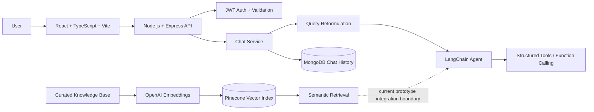

# chatbotRAG

A full-stack conversational AI prototype that explores **Retrieval-Augmented Generation (RAG), vector search, agent tool-calling, conversational memory, authentication, and a production-style web application layer**.

The project was built as a hands-on portfolio project to understand how modern LLM application components fit together beyond a simple chat-completion call.

> **Important:** This repository is an educational/portfolio prototype. It is **not a medical product** and must not be used for diagnosis, treatment, or crisis intervention. Any crisis-support behavior in the code should be treated as placeholder logic and updated to current, jurisdiction-specific resources before real-world use.

---

## What this project demonstrates

- Full-stack application development with **React, TypeScript, Node.js, Express, and MongoDB**
- Document embedding and vector indexing with **OpenAI Embeddings + Pinecone**
- **Semantic similarity search** and metadata-aware retrieval
- **Query reformulation** for more retrieval-friendly user queries
- Agent orchestration with **LangChain**
- **OpenAI function calling** and custom tool execution
- Structured tool inputs with **Zod schemas**
- Session-based conversational history stored in MongoDB
- JWT-based authentication with signed, HTTP-only cookies
- Request validation, rate limiting, security middleware, and centralized API handling
- Separation between a standard LLM chat path and an experimental RAG/agent path

---

## Architecture



### High-level request flow

1. A user signs in and starts or resumes a chat session.
2. The React client sends the message and session ID to the Express API.
3. The backend loads recent conversation history from MongoDB.
4. The user query is reformulated into a more retrieval-friendly form.
5. A LangChain agent processes the request and can call structured tools when appropriate.
6. The assistant response and user message are persisted to MongoDB.
7. Separately, the project includes a Pinecone indexing and semantic-retrieval pipeline for the curated knowledge base.

---

## RAG and retrieval pipeline

### Knowledge base

The repository includes a small curated JSON knowledge base containing mental-health resources. Each record includes fields such as:

- `title`
- `content`
- `source`
- `category`
- `url`

The current dataset is intentionally small and exists to demonstrate the retrieval architecture rather than production-scale knowledge management.

### Embedding and indexing

`backend/src/scripts/index_data.ts`:

1. Reads the JSON knowledge base.
2. Generates an embedding for each document using `OpenAIEmbeddings`.
3. Creates/uses a Pinecone index named `mental-health-index`.
4. Stores each vector with metadata including:
   - title
   - source
   - category
   - original page content
5. Uses cosine similarity as the vector-index metric.

The original implementation uses the OpenAI embedding model configured in the source code. Model/API selections reflect the ecosystem available when the project was built and should be reviewed when modernizing the project.

### Semantic retrieval

`backend/src/scripts/test_pinecone.ts` demonstrates retrieval with `PineconeStore` and LangChain.

The retrieval test includes:

- semantic similarity search
- top-k retrieval
- metadata filtering (for example, filtering by document category)
- inspection of retrieved source/title/content metadata

This verifies the vector-indexing and retrieval layer independently from the chat application.

### Query reformulation

Before agent processing, the project reformulates conversational user messages into more retrieval-oriented queries.

For example, a vague input such as:

> “I feel stressed.”

can be rewritten toward a query such as:

> “stress management techniques”

The goal is to reduce the mismatch between conversational language and the wording likely to produce relevant retrieval results.

---

## Agent and tool-calling layer

The project uses LangChain's OpenAI-functions agent pattern with an `AgentExecutor`.

### Custom structured tool

A custom `StructuredTool` is implemented for crisis-support routing. The tool:

- has a named capability the model can choose to invoke
- uses a **Zod schema** to define/validate structured tool input
- demonstrates the difference between plain text generation and an agent that can decide to take an action

This is an example of **structured tool calling**, not a claim that the final model response itself is enforced against a JSON schema.

### Agent prompt behavior

The system prompt was designed to:

- produce supportive responses
- consider recent conversation history
- use trusted-resource context where available
- call the crisis-support tool when the model identifies an emergency-type request
- include a non-professional disclaimer

> The crisis-support implementation is a prototype and should be replaced with current, location-aware, professionally reviewed safety logic before any real-world deployment.

---

## Conversation history and session design

Chat history is stored in MongoDB and grouped by `sessionId`.

The backend retrieves the most recent messages for the active session to provide conversational context. The chat schema includes:

- user reference
- session ID
- message role
- message content
- metadata
- soft-delete flag
- timestamps

A compound index on user/session/time supports session-oriented history queries.

The frontend can:

- create a new session
- load previous sessions
- retrieve message history
- send a new message
- clear stored chat history

---

## Authentication and application security

The application includes a basic production-style authentication layer:

- password hashing with `bcrypt`
- JWT authentication
- signed cookies
- `httpOnly` cookies
- `secure` cookie behavior in production
- `SameSite=Strict`
- authentication middleware for protected chat routes
- request validation with `express-validator`
- login rate limiting
- `helmet` security middleware
- configurable CORS
- centralized error handling
- graceful shutdown handling for `SIGINT` / `SIGTERM`
- process-level handling for unhandled promise rejections and uncaught exceptions

These controls are useful application-engineering patterns, but they have **not** been independently security audited.

---

## Frontend

The frontend is built with:

- React 18
- TypeScript
- Vite
- Material UI
- React Router
- Axios
- Formik + Yup
- DOMPurify
- React Hot Toast
- Sass

The UI includes:

- signup/login flows
- protected routes
- chat interface
- typing/loading states
- chat-history/session navigation
- new-chat flow
- responsive layout
- theme support

A centralized Axios wrapper provides consistent API configuration and error handling, including credentialed requests for cookie-based authentication.

---

## Backend

The backend is built with:

- Node.js
- Express
- TypeScript
- MongoDB / Mongoose
- LangChain
- OpenAI SDK
- Pinecone
- Zod

Main responsibilities include:

- authentication and authorization
- chat-session persistence
- standard LLM chat completion
- experimental agent/RAG flow
- query reformulation
- custom tool calling
- vector-indexing scripts
- retrieval testing
- validation and error handling

---

## Technology stack

| Layer | Technologies |
|---|---|
| Frontend | React, TypeScript, Vite, Material UI, Axios |
| Backend | Node.js, Express, TypeScript |
| LLM / Agent | OpenAI, LangChain, OpenAI function calling |
| Retrieval | Pinecone, OpenAI Embeddings, cosine similarity |
| Validation | Zod, express-validator, Yup |
| Database | MongoDB, Mongoose |
| Auth / Security | JWT, bcrypt, signed cookies, Helmet, CORS, rate limiting |
| Dev / Ops | PM2, TypeScript compiler, Nodemon, Prettier |

---

## Current implementation status and engineering review

This repository is best described as an **agent-enabled RAG prototype**, rather than a production-ready RAG system.

### What is implemented

- document ingestion
- OpenAI embeddings
- Pinecone vector indexing
- semantic retrieval
- metadata filtering
- retrieval validation script
- query reformulation
- LangChain agent execution
- custom structured tool calling
- Zod tool schemas
- recent conversational context
- MongoDB chat persistence
- full authentication flow
- frontend/backend application integration

### Important current limitation

The indexing/retrieval layer and the agent layer are implemented, but in the current repository snapshot the retrieved top-k documents are **not explicitly injected into the final agent-generation context**.

The retriever is instantiated and passed during execution, but the current prompt/agent path does not consume retrieved documents as a dedicated context variable or retrieval tool.

That means the project demonstrates the major RAG components independently, but the final RAG wiring should be strengthened before describing the implementation as production-ready retrieval-grounded generation.

---

## How I would evolve this project today

If I were continuing this project now, I would prioritize the following improvements.

### 1. Complete the retrieval-to-generation path

Explicitly execute top-k retrieval and inject the retrieved documents into the model context, or expose retrieval as a dedicated agent tool.

Target flow:

```text
User Query
  -> Query Reformulation
  -> Query Embedding
  -> Pinecone Retrieval
  -> Top-k Documents + Metadata
  -> Context Injection / Retrieval Tool
  -> Agent + Tool Decision
  -> Grounded Response
```

### 2. Add user-facing citations and provenance

The current vectors already preserve source metadata. A production revision should propagate that metadata through the generation pipeline and return citations with the final answer.

Possible response metadata:

```json
{
  "answer": "...",
  "sources": [
    {
      "title": "...",
      "source": "..."
    }
  ]
}
```

This would improve traceability and make it easier to verify whether the model response is grounded in retrieved evidence.

### 3. Add structured model outputs

The project currently uses Zod for structured **tool inputs**. A stronger implementation would also enforce structured **model outputs** with a schema for fields such as:

- response
- source references
- confidence/quality signals
- safety flags
- whether human review is required

### 4. Add a formal RAG / LLM evaluation pipeline

The repository includes manual retrieval validation, but not a formal evaluation framework.

A stronger evaluation layer could measure:

- retrieval precision / recall at k
- answer relevance
- groundedness / faithfulness
- citation correctness
- hallucination rate
- latency
- token usage / cost
- tool-selection accuracy

A fixed evaluation dataset would also make prompt, retrieval, and model changes measurable rather than subjective.

### 5. Improve retrieval quality

Potential improvements include:

- document chunking rather than one vector per full resource
- hybrid retrieval (semantic + keyword/BM25)
- reranking
- configurable top-k
- metadata-aware retrieval policies
- deduplication
- query expansion

### 6. Add production observability

A production version should add structured telemetry for:

- request latency
- retrieval latency
- model latency
- token/cost usage
- tool calls
- retrieval results
- errors/retries
- safety events

This would make debugging and operational monitoring significantly easier.

### 7. Strengthen safety and human oversight

Because the prototype is in a sensitive mental-health domain, a real implementation would require much stronger safeguards, including:

- professionally reviewed crisis-routing logic
- current, location-aware emergency resources
- clear escalation boundaries
- human-in-the-loop review for high-risk workflows
- audit logging
- privacy/data-retention controls
- formal evaluation of unsafe or misleading responses

### 8. Modernize model and dependency choices

The repository reflects the OpenAI/LangChain model and API choices used when it was built. Before redeploying it, I would review:

- currently supported chat models
- currently supported embedding models
- LangChain agent/tool APIs
- Pinecone/LangChain integration APIs
- dependency security updates

The architectural concepts remain relevant even when individual model names and library APIs change.

### 9. Add automated testing

The current repository does not contain a complete automated test suite. I would add:

- unit tests for validation and utilities
- API integration tests
- authentication tests
- retrieval tests with expected documents
- agent/tool-selection tests
- end-to-end chat tests
- regression tests for safety-sensitive queries

---

## What I learned from this project

The main value of this project was learning that an LLM application is much more than a model API call.

A useful AI product requires coordination across:

- knowledge ingestion
- embeddings
- retrieval
- prompt design
- agent/tool orchestration
- conversation state
- application APIs
- authentication
- persistence
- error handling
- frontend UX
- safety and evaluation

It also reinforced the importance of reviewing the entire data path end-to-end. Individual components can work correctly in isolation while an integration boundary still prevents the system from achieving the intended behavior.

That engineering lesson is one of the reasons I would now prioritize explicit retrieval-context wiring, citations, evaluation, and observability when taking a RAG system from prototype to production.

---

## Local setup

### Prerequisites

- Node.js
- npm
- MongoDB database/cluster
- OpenAI API credentials
- Pinecone account/index access

### Backend environment variables

Create a local backend `.env` file and configure values for the variables used by the application, for example:

```env
PORT=3001
NODE_ENV=development

OPENAI_API_KEY=your_openai_key
OPENAI_ORAGANIZATION_ID=your_optional_org_id

PINECONE_API_KEY=your_pinecone_key
PINECONE_ENVIRONMENT=your_pinecone_region

MONGODB_USER=your_mongodb_user
MONGODB_PASSWORD=your_mongodb_password
MONGODB_CLUSTER=your_mongodb_cluster
MONGODB_DATABASE=your_database_name

JWT_SECRET=replace_with_a_strong_secret
COOKIE_SECRET=replace_with_a_strong_secret
ALLOWED_ORIGINS=http://localhost:5173
```

> Never commit `.env` files or real credentials to Git. If credentials were ever committed historically, rotate them and remove them from Git history before making the repository public.

### Frontend environment variables

```env
VITE_NODE_ENV=development
VITE_API_URL=http://localhost:3001/api/v1
```

### Install and run the backend

```bash
cd backend
npm install
npm run dev
```

### Index the knowledge base

Run the indexing script with the backend environment configured. The script creates/uses the Pinecone index and uploads embeddings for the curated resource data.

Depending on your local TypeScript runner, for example:

```bash
npx tsx src/scripts/index_data.ts
```

### Validate retrieval

```bash
npx tsx src/scripts/test_pinecone.ts
```

### Install and run the frontend

```bash
cd frontend
npm install
npm run dev
```

The frontend development server will use `VITE_API_URL` to communicate with the backend.

---

## Repository structure

```text
chatbotRAG/
├── backend/
│   ├── data/
│   │   └── mental_health_resources.json
│   └── src/
│       ├── config/
│       ├── controllers/
│       ├── middleware/
│       ├── models/
│       ├── routes/
│       ├── scripts/
│       │   ├── index_data.ts
│       │   └── test_pinecone.ts
│       ├── services/
│       │   └── ChatAgentService.ts
│       └── utils/
├── frontend/
│   └── src/
│       ├── components/
│       ├── context/
│       ├── hooks/
│       ├── pages/
│       ├── services/
│       └── styles/
└── README.md
```

---

## Portfolio context

This project was created to explore practical **RAG and agentic AI application engineering** within a complete software product rather than as an isolated notebook experiment.

The focus was on connecting AI concepts with the application-engineering skills needed to build usable systems: APIs, databases, authentication, state, tools, retrieval, UI, and deployment-oriented design.

---

## Disclaimer

This software is a portfolio/educational prototype and is not intended to provide medical, psychological, diagnostic, treatment, or emergency services. The included knowledge base, prompts, and crisis-support logic have not been clinically validated and must not be relied on for real-world health or safety decisions.
